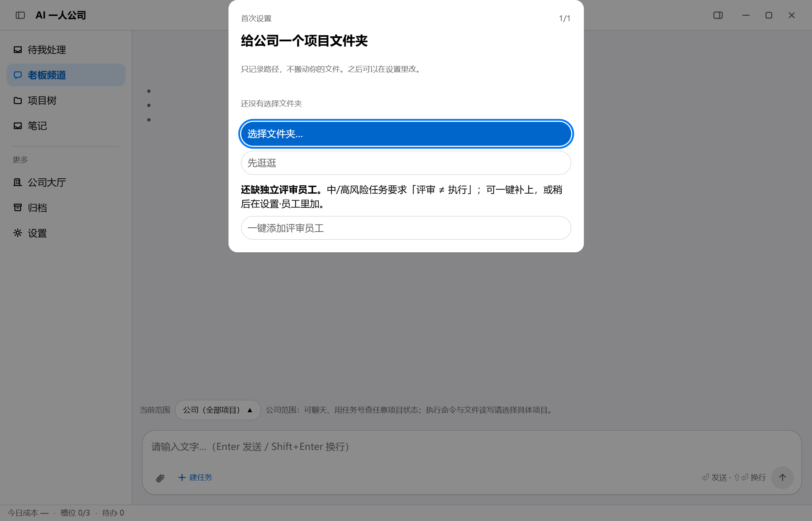

# AI 一人公司（AICompany）

> 一个本地优先的桌面 AI 工作台：你只跟「幕僚长」对话，它招募 AI 员工、拆任务、按闸门
> （计划评审 → 执行 → 验收）交付结果。**无服务端、无账号、无遥测；模型 Key 由你自带（BYO-key）。**



## 适合谁

- 想把重复的开发/内容工作交给一组可审计的 AI 员工的个人开发者；
- 在意数据留在本机、不接受把项目/密钥上传云端的用户；
- 愿意自带模型 Key（DeepSeek / MiMo 等 OpenAI 兼容供应商）。

**不适合**：需要多人协作/云端同步/企业 SSO 的团队；需要开箱即用、不愿配置模型 Key 的用户。

## 能做什么

- **老板频道**：自然语言派活；幕僚长拆解、招募员工、按风险等级走计划评审与验收。
- **任务与闸门**：计划可编辑、critic 评审、verifier 独立验收；决策/异常卡进「待我处理」。
- **项目与工作区**：多项目、按项目范围隔离；任务在项目目录内执行（可配权限档）。
- **笔记 / 产物**：知识页读写、Markdown 只读渲染、产物多版本语义、全局搜索。
- **成本与调度**：槽位、今日成本、项目级预算；模型目录与项目模型策略。
- **微信通道（可选）**：单 owner 扫码接入；非 owner 不启用。

详细能力与边界见 [docs/FEATURES.md](docs/FEATURES.md)，新手指引见 [docs/USER-GUIDE.md](docs/USER-GUIDE.md)。

## 安装

从 [Releases](https://github.com/phonedu/ai-company/releases) 下载 Windows 安装包：

- **安装器**：按当前用户安装，可改目录；卸载不删除任务/笔记/设置。
- **免安装版**：直接运行；自动更新仅安装版可用。

> 当前版本**未做代码签名**，Windows SmartScreen 会提示「未知发布者」；请核对 Release 里的
> SHA-256 后选择「仍要运行」。

## 数据与隐私

- 任务/笔记/账本：本地 SQLite（Windows `%APPDATA%\ai-company`）；
- 模型 Key：`~/.aico/secrets`，不写入日志、不上传；
- 项目文件：只在你接入的项目目录内读写；无云同步、无遥测。
- 备份、迁移、彻底删除见 [docs/DATA.md](docs/DATA.md)。

## 开发

```bash
pnpm install
pnpm test
pnpm build
pnpm dev
```

架构见 [docs/ARCHITECTURE.md](docs/ARCHITECTURE.md)；贡献流程见 [CONTRIBUTING.md](CONTRIBUTING.md)。

## 文档

- [功能与边界](docs/FEATURES.md) · [使用指南](docs/USER-GUIDE.md) · [数据与隐私](docs/DATA.md)
- [架构](docs/ARCHITECTURE.md) · [安全](SECURITY.md) · [FAQ](docs/FAQ.md) · [路线图](docs/ROADMAP.md)
- [提示词与可审计性](docs/PROMPTS.md) · [更新日志](CHANGELOG.md)

## 许可

- 代码：**GPL-3.0-or-later**（见 [LICENSE](LICENSE)）；商业闭源分发可另行取得 [商业许可](COMMERCIAL.md)。
- 文档：**CC BY-SA 4.0**（见 [LICENSE-DOCS](LICENSE-DOCS)）。
- 名称/Logo 不随代码授权，见 [TRADEMARK.md](TRADEMARK.md)。

贡献需同意 [CLA](CLA.md)。本项目按 best-effort 维护，不承诺路线图与 SLA。
